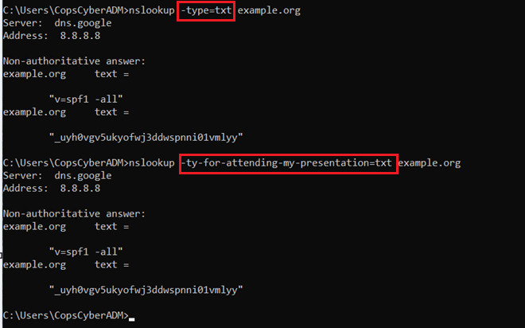
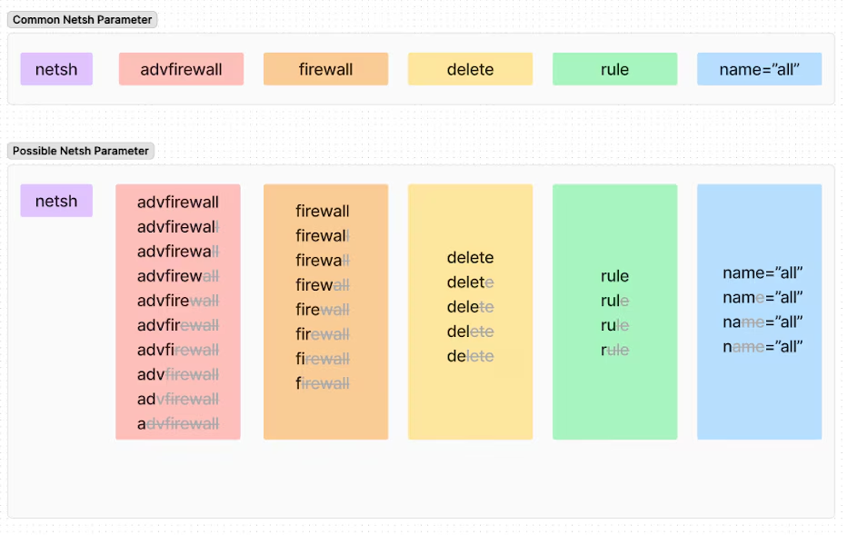

# Demo 01 - Parameter Variation

> *"PowerShell's `-EncodedCommand` can be invoked via 75 different flag spellings - 163,850 if you count casing. How many does your rule cover?"*

## The Bypass

Windows command-line parsers are forgiving, and `powershell.exe` is worse than forgiving - it does not use PowerShell's cmdlet parameter binder at all. Its native argument parser walks a small hardcoded list, which produces an equivalence class you cannot predict from the documentation:

- **Every prefix of the name works.** `-encodedcommand`, `-encodedcomman`, ... `-enc`, `-en`, `-e`.
- **`-e` binds `-EncodedCommand`** even though `-ExecutionPolicy` and `-EncodedArguments` also start with `e`. It is not resolving *unambiguous* prefixes - it is walking an ordered list. (`-ex` binds `-ExecutionPolicy`.)
- **`-ec` works**, and `ec` is not a prefix of `encodedcommand`. It is a *lone* alias, not a pattern - brute-force all 26 two-letter `e?` forms and only `ec` and `en` are accepted (and `en` is a genuine prefix); extend each by a letter and only `enc` survives. There is exactly one alias here, and no rule that would let you predict it.
- **The prefix character** can be `-`, `/`, or a Unicode **en dash**, **em dash** or **horizontal bar** (U+2013, U+2014, U+2015). Other dashes that look identical - U+2010, U+2011, U+2012, U+2212 - do not work.
- **Case is ignored** everywhere.

That is 75 distinct spellings, or 163,850 counting casing. A Sigma rule that hunts for the single literal `-EncodedCommand` covers 1 of those 75 - but casing is free, because plain Sigma string matching is case-insensitive by default, so it already catches all 16,384 casings of that one spelling. What it misses is every *other* abbreviation and every alternative prefix character.

## ADE Category

**ADE1-01 Substring Manipulation + ADE2-01 Omit Alternatives.** Two bugs stacked in one rule, and it is worth separating them:

- The flag spellings (`-e`, `–enc`, `-EnCoDeD...`) are **ADE1-01**. Same binary, same parameter, same behaviour - different bytes in the log.
- The missing `pwsh.exe` is **ADE2-01**. A genuinely different binary that achieves the same outcome and isn't in the rule.

Fixing one does not fix the other. That is the pattern for the rest of this lab.
## Illustrative Payload

All of these, and more, execute the same Base64-encoded payload:

```text
powershell.exe -EncodedCommand <b64>
powershell -EncodedCommand <b64>
powershell -encodedcommand <b64>
powershell -encod <b64>
powershell -ec <b64>
powershell -e <b64>
powershell /EncodedCommand <b64>
powershell /e <b64>
pwsh -e <b64>
```

(And many permutations involving casing, dashes vs. en-dashes, whitespace tricks, etc.)

The PowerShell parser accepts every unique prefix of `EncodedCommand` - and accepts `-`, `/`, an em-dash and an en-dash as the parameter prefix. That's a lot of variations!

The bypass isn't unique to PowerShell. Many built-in Windows tools accept any unambiguous prefix of a flag name. `nslookup` famously accepts entire sentences as the flag - as long as the prefix is unique:



And `netsh` exhibits a combinatorial explosion of valid abbreviations across every parameter:


<br>
[SOURCE](https://www.splunk.com/en_us/blog/security/netsh-firewall-evasion-techniques.html)

## Vulnerable Rule

```yaml
title: PowerShell Encoded Command (Naive)
id: 11111111-1111-1111-1111-000000000001
status: experimental
description: Detects PowerShell launched with -EncodedCommand
logsource:
  product: windows
  category: process_creation
detection:
  selection:
    Image|endswith: '\powershell.exe'
    CommandLine|contains: '-EncodedCommand'
  condition: selection
falsepositives:
  - Legitimate scheduled tasks
level: medium
```

## Why It Misses

The `CommandLine|contains: '-EncodedCommand'` clause matches that *one* spelling in any casing - Sigma string matching is case-insensitive by default - but no other spelling. An attacker using `-ec`, `-e`, `/EncodedCommand`, or `-encod` walks straight past it. The rule also forgets that `pwsh.exe` (PowerShell 7+) is a separate binary with the same flag semantics.

## Your Turn - Harden the Rule

**Goal.** Write a Sigma rule that fires on PowerShell Encoded Command execution regardless of which flag spelling the attacker uses.

**Constraints.**
- Cover all five prefix characters: `-`, `/`, U+2013, U+2014, U+2015.
- Cover every valid prefix abbreviation of `EncodedCommand` (from `e` through the full word), plus the `ec` alias.
- Cover both `powershell.exe` and `pwsh.exe` (PowerShell 7+).
- Do **not** fire on `-ExecutionPolicy`, `-EncodedArguments`, or `-File`.
- Do **not** fire on a benign path or URL that happens to contain `-e` or `/e` followed by a non-word character - test yours against `powershell.exe -File "C:\logs\app-e.log.ps1"` before you ship it.

**Hints.**
- Sigma supports the `re|i` modifier for case-insensitive regex matching.
- Word boundaries (`\b`) help with the FP-avoidance constraint - but think about the *start* of the token as well as the end.
- The base64 payload itself contains `/` and `+`. Does your pattern match inside it?

**Reflection.** Once you've drafted your rule, compare it to [`../../solutions/README.md`](../../solutions/README.md#demo-01--parameter-variation). What did you cover? What did you miss? What would you change about our version?

## Exercises

1. Rewrite the hardened rule for a different SIEM query language of your choice.

2. The hardened rule covers `-EncodedCommand` variations. Find at least three *other* PowerShell flags an adversary would use to execute hostile code that this rule doesn't cover. (Hint: think about what `-EncodedCommand` is *for*, and what alternate ways exist to achieve the same outcome.)

3. Combine this bypass with **Demo 03 (Whitespace)**. Construct a command line where both bypasses apply simultaneously. Does the hardened rule still catch it? If not, why?

4. A behavioral-invariant detection ignores *how* the command was invoked and instead detects *what it does*. Sketch (in pseudocode) a behavioral detection that catches "PowerShell decoded a Base64 blob and executed it" - without relying on command-line content at all. What telemetry source would you need?
