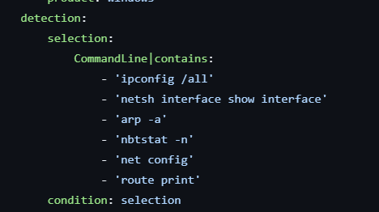
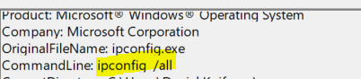

# Demo 03 - Whitespace Manipulation

## The Bypass

Static rules that hunt for command lines as exact substrings live or die by their whitespace assumptions. Two related problems combine to defeat them.

First, several native Windows binaries (and the cmd.exe parser itself) emit *more whitespace than the operator typed*. Run `ipconfig /all` from CMD and the resulting process telemetry shows `ipconfig  /all` - two spaces between the binary and the flag, even though only one was typed. This is the parser, not the attacker.

Second, attackers exploit the same parser permissiveness deliberately, inserting extra spaces between tokens to break literal-substring detections that were tuned against the canonical one-space form.

Either way, a rule that searches for `'ipconfig /all'` (one space) misses telemetry that contains `'ipconfig  /all'` (two or more spaces).

## ADE Category

**ADE1 - Reformatting in Actions.** Same execution, different bytes. The semantic meaning of the command line is identical to the parser, but the byte-level pattern differs from what the rule expects.

## Illustrative Payload

```text
:: What the rule expects:
ipconfig /all
cmd.exe /c whoami

:: What the parser actually produces (or what an attacker types):
ipconfig  /all          (two spaces - produced automatically by cmd.exe in some invocation paths)
cmd.exe  /c  whoami     (extra spaces inserted between every token)
```

The bytes are different. The execution is identical. Process command-line telemetry preserves the exact bytes, so the rule sees the parser-produced or attacker-inserted version - never the canonical one.

## Vulnerable Rule

A typical recon-detection ruleset hunts for a list of literal command lines:



```yaml
title: ipconfig (naive)
id: 33333333-3333-3333-3333-000000000001
status: experimental
description: Detects ipconfig /all
logsource:
  product: windows
  category: process_creation
detection:
  selection:
    CommandLine|contains: 'ipconfig /all' #one space
  condition: selection
level: low
```

In production, the rule was written assuming the canonical one-space form. The actual telemetry - whether the operator typed extra spaces, or cmd.exe added them on its own - looks like this:



## Why It Misses

`CommandLine|contains: 'ipconfig /all'` requires that exact byte sequence: binary, single space, command. Add any extra space anywhere inside that span and the substring is no longer present in the command line. The rule fires on zero events whenever this bypass applies.

## Your Turn - Harden the Rule

**Goal.** Write a Sigma rule that detects suspicious recon execution regardless of how many whitespace characters appear between tokens.

**Constraints.**
- Match `whoami`, `ipconfig /all`, `net config` and similar reconnaissance commands.
- Tolerate one or more whitespace characters between any two tokens.
- Don't normalize so aggressively that you lose the signal of *which command* was actually run.

**Hints.**
- The `Image` / `OriginalFileName` fields are populated from OS process metadata, not parsed from the raw command line — so extra whitespace *between command-line tokens* doesn't affect them.
- Sigma's `re|i` modifier lets you write a regex that uses `\s+` between tokens.
- For some demos the cleanest fix isn't a regex at all - it's matching on the resolved binary identity.

**Reflection.** Compare your rule to the maintainer's in [`../../solutions/README.md`](../../solutions/README.md#demo-03--whitespace-manipulation).

## Exercises

1. In your own words: why is this an ADE1 ("reformatting") bypass and not an ADE4 ("logic manipulation") bypass? Both can produce false negatives. What distinguishes a *bytes-the-rule-sees* bug from a *the-rule's-logic-itself-is-broken* bug?

2. Suppose your hardened rule uses `\s+` to tolerate any number of whitespace characters between `cmd.exe`, `/c`, and `whoami`. Now defeat that rule *without* using whitespace tricks at all - name two ways an attacker could invoke `whoami` reconnaissance that bypass your tokenized regex.

3. Combine this with **Demo 05 (Quote Manipulation)**. Construct a `cmd.exe` command that executes `whoami` while defeating both literal-quote and literal-whitespace matches. How many distinct primitives does the hardened rule need to cover?

4. The behavioral-invariant fix shifts to detecting `whoami.exe` as a process. But that fires on every legitimate use of `whoami` too. How would you score the *suspicion level* without emitting an alert on the benign baseline? (Hint: think about parent process, surrounding telemetry.)
