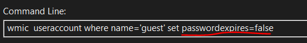
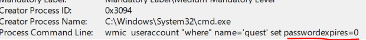

# Demo 04 - Boolean Replacement

> *"1 or TRUE, 0 or FALSE - gotta catch them all"*

## The Bypass

PowerShell, JavaScript, Python, and most scripting languages accept many syntactic forms for the same boolean value. PowerShell in particular is permissive:

- `$true` and `$false` (canonical)
- `1` and `0` (numeric coercion)
- `[bool]1` (explicit cast)
- `[bool]::Parse('true')` (method call)
- `(1 -eq 1)` (expression that evaluates to `$true`)
- A switch parameter without a value (`-Force` is equivalent to `-Force:$true`)

A rule looking for `-Force:$true` matches exactly one of these forms. Every other form on the list — plus the infinite set of expressions that evaluate to `$true` — sails past.

## ADE Category

**ADE1 - Reformatting in Actions.** Same semantic value (`true`), expressed in many different byte sequences. The parser/runtime resolves them to the same thing, but the static rule sees only what it was trained on.

## Illustrative Payload

All of these execute `Remove-Item` with the force flag:

```powershell
Remove-Item -Path 'C:\sensitive' -Recurse -Force:$true
Remove-Item -Path 'C:\sensitive' -Recurse -Force:1
Remove-Item -Path 'C:\sensitive' -Recurse -Force
Remove-Item -Path 'C:\sensitive' -Recurse -Force:([bool]1)
Remove-Item -Path 'C:\sensitive' -Recurse -Force:([bool]::Parse('tr' + 'ue'))
Remove-Item -Path 'C:\sensitive' -Recurse -Force:(1 -eq 1)
```

### Real-world example: WMIC password expiration

A rule hunting for "disable password expiration" looks for the literal `passwordexpires=false`:



The attacker writes the equivalent using `0` instead of `false` - same effect, different bytes:




## Vulnerable Rule

```yaml
title: Forced Recursive Removal (Naive)
id: 44444444-4444-4444-4444-000000000001
status: experimental
description: Detects PowerShell deleting items recursively with force
logsource:
  product: windows
  category: ps_script
detection:
  selection:
    ScriptBlockText|contains:
      - '-Recurse -Force:$true'
      - '-Force:$true -Recurse'
  condition: selection
level: medium
```

## Why It Misses

The rule enumerates two literal orderings of `-Recurse -Force:$true`. It misses:

- `-Force` (without explicit value)
- `-Force:1`, `-Force:0`, `-Force:([bool]1)`, etc.
- Splatting (`Remove-Item @params` where `$params = @{Recurse=$true; Force=$true}`)
- Aliases of `Remove-Item` (`del`, `erase`, `rd`, `rm`, `ri`, `rmdir`)

Plus all the obvious orderings the rule didn't think to enumerate.

## Your Turn - Harden the Rule

**Goal.** Write a Sigma rule that detects forced recursive deletion via PowerShell - regardless of how the boolean values for `-Force` and `-Recurse` are expressed.

**Constraints.**
- Catch all six (or more) syntactic forms of `-Force:$true` (`-Force`, `-Force:1`, `-Force:([bool]1)`, `-Force:(1 -eq 1)`, etc.).
- Cover all aliases of `Remove-Item` (`del`, `erase`, `rd`, `rm`, `ri`, `rmdir`).
- Don't false-positive on every legitimate cleanup script.
- The rule should focus on *intent*, not *byte-level pattern*.

**Hints.**
- Boolean *values* are infinitely variable. Boolean *parameter names* are not.
- What's the smallest set of things you need to detect? Cmdlet name + parameter names + maybe scope?
- Is there a behavioral telemetry source that catches the *outcome* (mass file deletion) regardless of how the deletion was invoked?

**Reflection.** Compare your rule to the maintainer's in [`../../solutions/README.md`](../../solutions/README.md#demo-04--boolean-replacement). The maintainers offer both a script-content rule and a behavioral approach. Which one would you ship first?

## Exercises

1. PowerShell switch parameters can be specified five ways: bare, `:$true`, `:$false`, `:1`, `:0`. Why do most detection engineers default to writing `:$true` in their rules? What does that say about the gap between *how engineers think about boolean values* and *how parsers do*?

2. Rewrite the hardened rule's spirit for **bash**. The shell equivalent might be `rm -rf` - list at least four ways to invoke `rm` that defeat a literal `rm -rf` substring match.

3. The hardened rule fires on the conjunction of `Remove-Item`-family + `-Force` + `-Recurse`. Bypass it by achieving the same outcome (recursive force-deletion) without using the `-Recurse` flag. (Hint: PowerShell has more than one cmdlet that walks directories.)

4. Combine with **Demo 08 (Obfuscation)**. Write a payload where the entire `Remove-Item -Recurse -Force` invocation is constructed via string concatenation. Does Script Block Logging save the rule? If yes, what enables that - and why isn't it always enabled?

5. Sketch a behavioral detection that fires when "any process recursively deletes more than N files in a sensitive directory within T seconds." It should ignore *how* the deletion was invoked (PowerShell, cmd, Win32 API directly). What telemetry source provides the count? What's a reasonable threshold for N and T?

