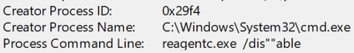

# Demo 05 - Quote Manipulation

> *"`whoami` truly?"*

## The Bypass

Windows command-line parsers (cmd.exe, PowerShell) treat several quoting characters as **delimiters that get stripped** before the binary receives its arguments. An attacker can inject quotes anywhere in a command - even in the middle of a single token - and the result is the same execution. The byte-level command line, however, looks completely different.

Three families of quoting tricks:

1. **Wrapping** - `"whoami"` instead of `whoami`
2. **Mid-token quoting** - `who"a"mi`, `wh"oa"mi`, `w"hoami"`
3. **Mixed-style quoting** - single quotes inside double quotes (PowerShell), backticks (PowerShell), or none at all where the rule expects them

## ADE Category

**ADE1 - Reformatting in Actions.** The execution is identical; the static representation differs. The rule's literal-string match is defeated by trivial syntactic restructuring.

## Illustrative Payload

A real-world example. A rule looking for `reagentc.exe /disable` (the command that turns off Windows Recovery Environment - a common ransomware precursor) sees this on the wire:



`reagentc.exe /dis""able` - the parser strips the empty `""` and resolves the flag to `/disable`. The literal substring match for `/disable` fails entirely.

The same family of tricks applies to *any* command. All of these execute `whoami`:

```text
:: cmd.exe contexts
whoami
"whoami"
who"a"mi
wh""oami
w"hoam"i

:: PowerShell contexts
whoami
'whoami'
"whoami"
& 'whoami'
& "who$('a')mi"
. ('w'+'h'+'o'+'a'+'m'+'i')
```

`whoami.exe` is invoked in every case. The `Image` field of the process-creation event is identical. The `CommandLine` field is wildly different.

The reagentc example is harder than the whoami example because the *binary* is not what the rule cares about - the *flag* is. And the flag lives in CommandLine, where the quote tricks live.

## Vulnerable Rule

A naive detection for the WRE-disable ransomware precursor:

```yaml
title: Windows Recovery Environment Disabled (Naive)
id: 55555555-5555-5555-5555-000000000001
status: experimental
description: Detects reagentc.exe being used to disable Windows Recovery Environment
logsource:
  product: windows
  category: process_creation
detection:
  selection:
    Image|endswith: '\reagentc.exe'
    CommandLine|contains: '/disable'
  condition: selection
level: high
```

## Why It Misses

`CommandLine|contains: '/disable'` looks for the contiguous 8-byte sequence `/disable`. Splice an empty `""` anywhere inside it - `/dis""able`, `/d""is""able`, `/"d"i"s"a"b"l"e` - and the literal substring is no longer present. The parser still resolves the flag to `/disable` and WRE still gets disabled; the rule never fires.

Image-only matching (drop the `CommandLine` clause entirely) doesn't solve the problem either. `reagentc.exe` has legitimate uses (`/info`, `/enable`, `/boottore`, vendor maintenance scripts). Firing on every reagentc invocation buries the SOC in false positives.

## Your Turn - Harden the Rule

**Goal.** Write a Sigma rule (or detection strategy) that catches `reagentc.exe /disable` regardless of how the attacker splices quotes into the flag - without firing on legitimate reagentc usage.

**Constraints.**
- Catch `/disable`, `/dis""able`, `/"d"i"s"a"b"l"e`, `'/disable'`, and any combination.
- Must NOT fire on `reagentc.exe /enable`, `/info`, `/boottore`, or other legitimate flags.
- Image-only matching is insufficient - it produces too many false positives.

**Hints.**
- Can you detect the *side effect* instead? `/disable` clears the `recoveryenabled` element in the BCD store (the `HKLM\BCD00000000` registry hive) and rewrites `ReAgent.xml` - what telemetry surfaces those?
- The worst-case bypass constructs `/disable` from non-string sources (env vars, file content). Where does that bypass meet its match?

**Reflection.** Compare your rule to the maintainer's in [`../../solutions/README.md`](../../solutions/README.md#demo-05--quote-manipulation).

## Exercises

1. When the threat is the *binary itself* (e.g., `mimikatz.exe`), `Image|endswith` handles the command-line reformatting bypasses (quotes, whitespace, case). When the threat is a *specific flag* of an otherwise-benign binary (`reagentc /disable`), Image-only matching produces too many false positives. Explain this distinction in your own words. What does it tell you about when "match the parsed Image field" is and isn't a sufficient ADE1 fix? (Follow-up: `Image` matches the *filename*, so renaming the binary - MITRE T1036.003 - slips it; what would you add for durable identity?)

2. Suppose your SIEM doesn't expose a parsed argument list - just the raw command line. Sketch a normalization pipeline (3-6 steps) that would let you reliably match `/disable` regardless of quoting. What edge cases would break your normalization (i.e., where would the attacker still slip through)?

3. Your hardened rule catches `reagentc.exe /disable` in any quote-spliced form. Bypass it by disabling Windows Recovery Environment *without* invoking `reagentc.exe` at all. Name at least two alternative paths.

4. Combine with **Demo 03 (Whitespace)**. Construct a payload that disables WRE while defeating literal matches against the flag *and* the whitespace separators. How many distinct evasion primitives does the hardened rule need to handle?

5. A behavioral detection for "WRE disable attempt" should fire regardless of which path the attacker uses - reagentc.exe, bcdedit, or a direct registry/BCD write. What's the *behavioral invariant* that links them? Sketch the rule, naming the telemetry source for each path.
