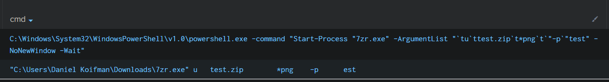
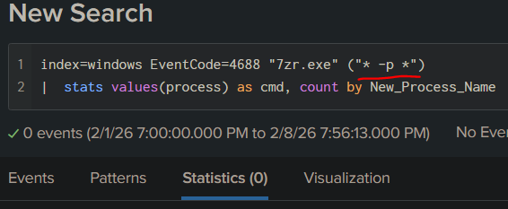

# Demo 06 - Delimiter Manipulation

> *"Your rule expects `;`. The shell also accepts `&`, `&&`, `|`, and (in PowerShell) the pipeline operator. Pick one."*

## The Bypass

Shells offer multiple operators that sequence or combine commands. A detection that hunts for one specific separator misses payloads that use any other valid one.

**cmd.exe sequencing operators:**
- `&` - run B regardless of A's exit code
- `&&` - run B only if A succeeded
- `||` - run B only if A failed
- `|` - pipe A's stdout to B's stdin

**PowerShell sequencing operators:**
- `;` - sequential execution
- `|` - pipeline
- `&&` and `||` - **PowerShell 7+ only** (the pipeline chain operators were added in PowerShell 7.0). In Windows PowerShell 5.1 — the in-box host every other demo targets — `whoami && hostname` is a parse error: *"The token '&&' is not a valid statement separator in this version."* Use `;` on 5.1.

### Real-world example: PowerShell ArgumentList token-splitting

When PowerShell invokes a process via `Start-Process -ArgumentList`, the argument string is parsed and re-joined with whitespace before being handed to the target binary. The exact whitespace and quoting can shift in ways the SIEM doesn't expect:



A Splunk search hunting for `7zr.exe` with the literal `-p` flag (password) finds **zero** events - even though the binary did receive a `-p` argument. The argument-list parsing inserted different separators than the search expected:



Same execution. Same intent. Different delimiter handling. The rule misses entirely.

## ADE Category

**ADE1 - Reformatting in Actions.** The semantic flow (run command A, then command B) is preserved across all delimiters. Only the syntactic delimiter character changes.

## Illustrative Payload

All execute `whoami` then `hostname`:

```text
:: cmd.exe variants
whoami & hostname
whoami && hostname
whoami | hostname

:: PowerShell variants
whoami; hostname
whoami | Out-Null; hostname
```

## Vulnerable Rule

```yaml
title: Recon Chain via Semicolon (Naive)
id: 66666666-6666-6666-6666-000000000001
status: experimental
description: Detects whoami chained to hostname via semicolon
logsource:
  product: windows
  category: process_creation
detection:
  selection:
    CommandLine|contains: 'whoami; hostname'
  condition: selection
level: low
```

## Why It Misses

The literal `'whoami; hostname'` only matches that one delimiter. Switch to `&`, `&&`, `|`, or even just remove the space (`whoami;hostname`) and the substring no longer appears.

## Your Turn - Design the Detection

**Goal.** Detect a chain of recon binaries (`whoami`, `hostname`, `nltest`, etc.) executed in sequence - regardless of which delimiter (`;`, `&`, `&&`, `|`) the attacker used to chain them.

**Constraints.**
- Detect chains regardless of *which* delimiter (`;`, `&`, `&&`, `|`) the attacker used - whether typed in one shell or delivered as a single script. (Chains split across *different* parent processes - separate `cmd /c` calls, separate scheduled tasks - are a known limit you'll probe in the exercises.)
- The rule should not be a literal-string match on a delimiter - that's the bypass surface.
- A single recon binary running once is benign and noisy. Don't flood the SOC.

**Hints.**
- The signal isn't "delimiter X appeared" - it's "N recon binaries from one parent process in T seconds." Why?
- Sigma supports a `correlation` block for event-count aggregation. What `group-by` field captures "same parent"?
- What N and T values balance fidelity against false positives?

**Reflection.** Compare your detection to the maintainer's in [`../../solutions/README.md`](../../solutions/README.md#demo-06--delimiter-manipulation). What's the unit of analysis the maintainers chose, and how does that defeat the entire delimiter-bypass family at once?

## Exercises

1. This demo is filed under ADE1 (reformatting). One could argue it's actually ADE2 (omit alternatives) - the rule omits the alternative delimiters. Which is the better fit, and why? (Hint: think about whether the bypass is at the character level or the construct level.)

2. The hardened rule fires on 3+ recon binaries from a single parent in 60s. Defeat it. Name two distinct strategies.

3. Combine with **Demo 02 (Fragmentation & Chaining)**. Write a payload that chains three recon commands across a script file invoked via `cmd.exe /c <file>`. Does the hardened rule still fire? Why or why not?

4. "Recon binary chain" is one *family* of behavioral invariants. Name three other families where the same pattern (multiple LOLBins from one parent in a short window) reliably indicates malice. For each, list the binaries that participate.
