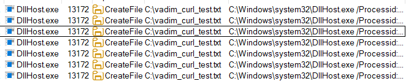

# Demo 07 - WSL for PowerShell

> *"Your Windows EDR doesn't see Linux processes. WSL is a Linux process. Now what?"*

## The Bypass

Windows Subsystem for Linux 2 (WSL2 - the default since 2020) runs a real Linux kernel and full Linux userland inside a lightweight utility VM. (WSL1, the legacy mode, instead translated Linux syscalls to the NT kernel - no separate kernel - but WSL2 is what ships today and what this demo targets.) Crucially:

- **WSL processes don't appear in classic Windows process telemetry.** Sysmon, Windows Event Log Process Creation (4688), and most EDR product telemetry track Win32 processes - they don't see what's running inside WSL.
- **PowerShell 7 (`pwsh`)** is packaged for most major Linux distributions, but it is **not** installed by default on the Ubuntu WSL image (Microsoft's docs: "Ubuntu comes preconfigured with a package repository that includes .NET packages, but not PowerShell"). An attacker with a shell in WSL adds it in one `apt` transaction, then uses it to read/write Windows files and make network connections — all invisible to Windows EDR. That install step is itself a signal, if you are collecting any WSL telemetry.
- **The `/mnt/c/` mount** lets WSL processes read and write Windows filesystem paths transparently.

**Important distinction:** Linux-native `pwsh` runs in a Linux process context — `whoami` returns the Linux username, not the Windows identity. It has no access to Windows process memory (LSASS), the Windows Credential Manager, or Win32 APIs. But it *can* read and exfiltrate files from the Windows filesystem via `/mnt/c/` (including credential files, browser profiles, SSH keys), download payloads, drop files for later Windows-side execution, and query network services (LDAP, SMB, WinRM) if the attacker has credentials. None of this generates Windows process telemetry. For running Windows binaries (e.g., `whoami.exe`, `net.exe`), WSL's interop layer is required — but interop calls *are* visible to Windows Sysmon (parent process: `wsl.exe`).

The result: an attacker in WSL can perform Windows-impacting *file and network operations* that produce *Linux* telemetry (which most Windows-shop SOCs don't ingest, parse, or rule on) instead of *Windows* telemetry.

## ADE Category

**ADE2 - Omit Alternatives.** The rule was written for `powershell.exe` / `pwsh.exe` running on the Windows host. It omits the alternative `pwsh` running inside WSL.

**Note: this bypass also has a telemetry-availability dimension that sits outside the ADE Framework.** The framework formalizes detection logic bugs - but here, even a perfect ADE2 fix (enumerate `pwsh`-on-WSL) can't fire if WSL telemetry never reaches the SIEM. That's a precondition problem, not a logic bug, and a real production fix needs ingestion changes (WSL audit log) on top of any rule update.

## Illustrative Payload

```bash
# From inside a WSL Ubuntu shell:

# Encoded payload using Linux base64 (different binary than Windows certutil)
echo 'SQBuAHYAbwBrAGUALQBXAGUAYgBSAGUAcQB1AGUAcwB0AC4ALgAu' | base64 -d > /mnt/c/Users/Public/dropper.ps1
```

The Windows EDR sees: a file appearing in `C:\Users\Public\`. No PowerShell ran.

In Process Monitor, the file write looks like this - created by `DllHost.exe` with no clear relationship to any user-launched program:



The actual command that produced this file ran in Linux (`pwsh` invoking `Invoke-WebRequest`). None of that telemetry exists on the Windows side.

## Vulnerable Rule

```yaml
title: PowerShell Web Download Cradle (Naive - Windows Only)
id: 77777777-7777-7777-7777-000000000001
status: experimental
description: Detects PowerShell invoking Invoke-WebRequest to download an executable
logsource:
  product: windows
  category: process_creation
detection:
  selection:
    Image|endswith:
      - '\powershell.exe'
      - '\pwsh.exe'
    CommandLine|contains|all:
      - 'Invoke-WebRequest'
      - '-OutFile'
  condition: selection
level: medium
```

## Why It Misses

The `Image|endswith` clause requires a Windows-side process. WSL's `pwsh` lives at `/usr/bin/pwsh` — a Linux path. From the perspective of Windows process telemetry, no `pwsh.exe` ever ran. The rule is correct for what it sees, but it sees nothing.

## Your Turn - Design the Detection Strategy

**Goal.** Detect WSL-mediated payload activity that touches the Windows filesystem, even though the WSL processes themselves are invisible to Windows EDR.

**Constraints.**
- This is not necessarily a single rule.
- The fundamental issue is telemetry availability - which the ADE Framework doesn't classify because it's not a detection logic bug, it's a precondition. Even a perfect rule fails if you can't see what's happening inside WSL.
- Don't FP on the *legitimate* WSL use cases (developer workflows in VS Code Remote, Windows Terminal users).

**Hints.**
- `wsl.exe` itself *is* a Win32 process and generates Windows process telemetry. What can you do with that signal?
- What's the most observable artifact when a WSL process writes to `/mnt/c/...`? Is it visible?
- What's the long-term fix that's not a SIEM rule at all?

**Reflection.** Compare your strategy to the maintainer's in [`../../solutions/README.md`](../../solutions/README.md#demo-07--wsl-for-powershell). What's the boundary between "things a rule can solve" and "things telemetry ingestion has to solve" for this bypass family?

## Exercises

1. This demo classifies as ADE2 (omit alternatives), but the *primary* failure mode is something the ADE Framework doesn't formally cover. Identify that other failure mode and explain why the framework excludes it. (Hint: ADE deals with detection logic bugs - what does this bypass do that ISN'T a logic bug?)

2. WSL is one example of a "telemetry crossover" bypass. List **three other Windows technologies** where a process boundary creates a similar visibility gap. (Hint: think containers, sandboxes, alternate runtimes.)

3. The hardened rule's part (b) flags file drops in `C:\Users\Public\`. Bypass it without leaving WSL.

4. Combine with **Demo 02 (Fragmentation & Chaining)**. Write a payload where the WSL-side drops a *script* into `/mnt/c/Users/Public/`, and a separate (legitimate-looking) Windows-side scheduled task or autostart picks it up later. Now there's no temporal correlation between the WSL invocation and the execution. What detection survives?

5. Sketch a behavioral-invariant detection for "data exfiltration via WSL": a Linux process inside WSL reads many files from `/mnt/c/Users/<someone>/Documents/` and then makes outbound network connections. What telemetry source provides each part? Is it ingestible into your current SIEM? If not, what would it cost?
